

<a href="https://stud-huzaifa.github.io/huzaifa-portfolio/">
  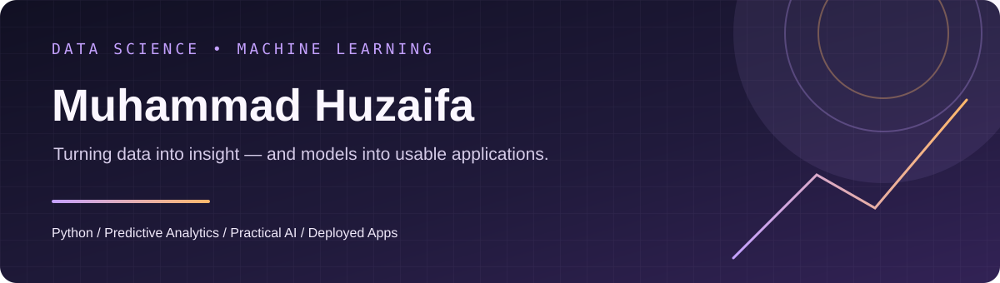
</a>

  
  
  

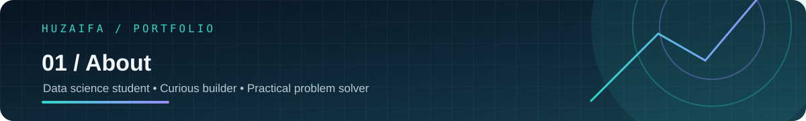

## Hi, I'm Muhammad Huzaifa

I'm a data science undergraduate in Karachi, Pakistan, who enjoys turning data into useful, working software. I build projects across the machine-learning workflow: exploring and preparing data, training and evaluating models, and presenting results through web apps and APIs.

My interests include applied machine learning, predictive analytics, and decision-support tools. I value clear explanations, thoughtful evaluation, and solutions that are useful beyond a notebook.

  
  
  

> *I like taking a question from raw data to a result people can understand and use.*

## Education

| Degree | Institution | Location |
| --- | --- | --- |
| **Bachelor of Science in Data Science** — undergraduate student | Dawood University of Engineering & Technology | Karachi, Pakistan |

I’m building my foundation in data science through university study and hands-on projects, with a practical focus on data analysis, machine learning, and communicating results clearly.

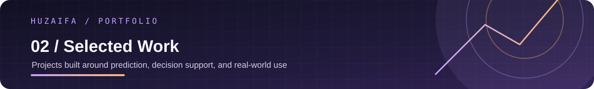

<a href="https://github.com/Stud-Huzaifa/Invoice-Intelligence-Machine-Learning-Project">
  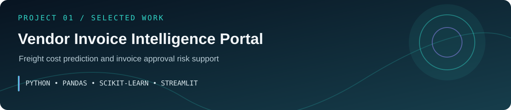
</a>

A finance-focused machine-learning application that estimates freight costs and flags invoices for approval-risk review. It brings both predictions into a Streamlit interface to support more consistent invoice review.

  
  
  

<a href="https://github.com/Stud-Huzaifa/customer-churn-app-retention-bussiness-intelligent-system">
  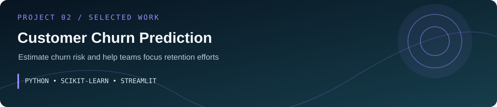
</a>

A deployed machine-learning app that estimates customer churn risk and groups customers into risk segments, giving teams a clearer starting point for retention analysis.

  
  
  

<a href="https://stud-huzaifa.github.io/huzaifa-portfolio/">
  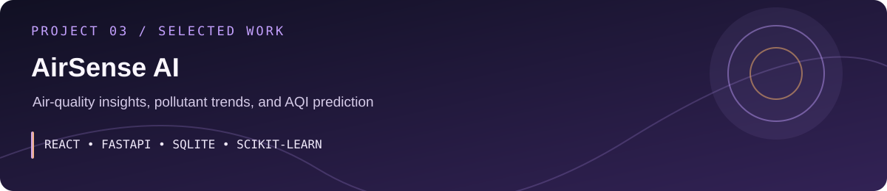
</a>

An environmental intelligence platform for exploring air-quality information and pollutant trends, estimating AQI, and presenting potential health-risk context.

  
  

<a href="https://github.com/Stud-Huzaifa/nvidia-stock-prediction">
  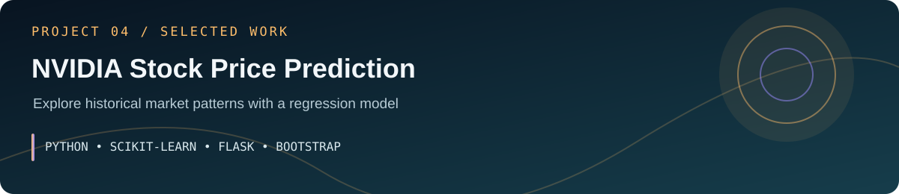
</a>

A regression project that uses historical NVIDIA market data to estimate the next day's price and explore patterns in time-dependent data.

  
  

<a href="https://github.com/Stud-Huzaifa/Breast-Cancer-Prediction">
  
</a>

A Flask application that serves predictions from a trained machine-learning classification model through a straightforward web interface.

  
  

  

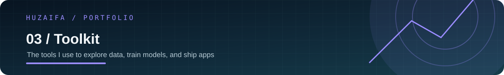

I use these tools across coursework and projects, choosing the stack to fit the problem:

| Area | Technologies |
| --- | --- |
| **Languages & data** | Python, SQL, Pandas, NumPy |
| **Machine learning** | Scikit-learn, model evaluation, predictive analytics |
| **Apps & APIs** | Streamlit, Flask, FastAPI, React |
| **Data & workflow** | SQLite, Git, GitHub, VS Code |

  

  
  
  
  
  
  
  

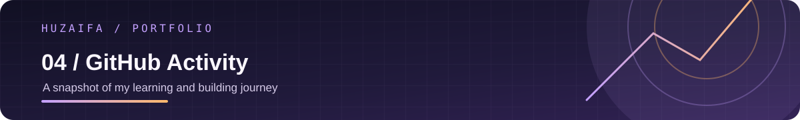

 

 

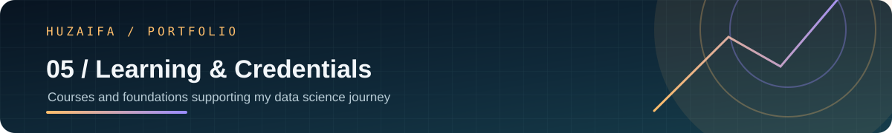

Additional coursework includes Python for Data Science and AI, data science tools, data visualization with Python, databases and SQL, and the applied data science capstone.

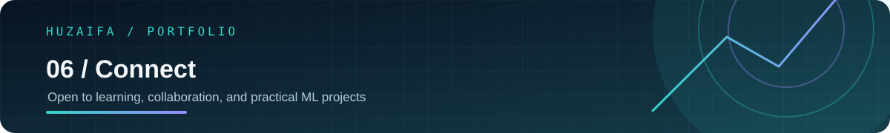

If you're working on data science, predictive analytics, or practical ML applications, I'd be glad to connect.

  
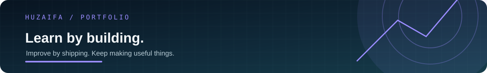

